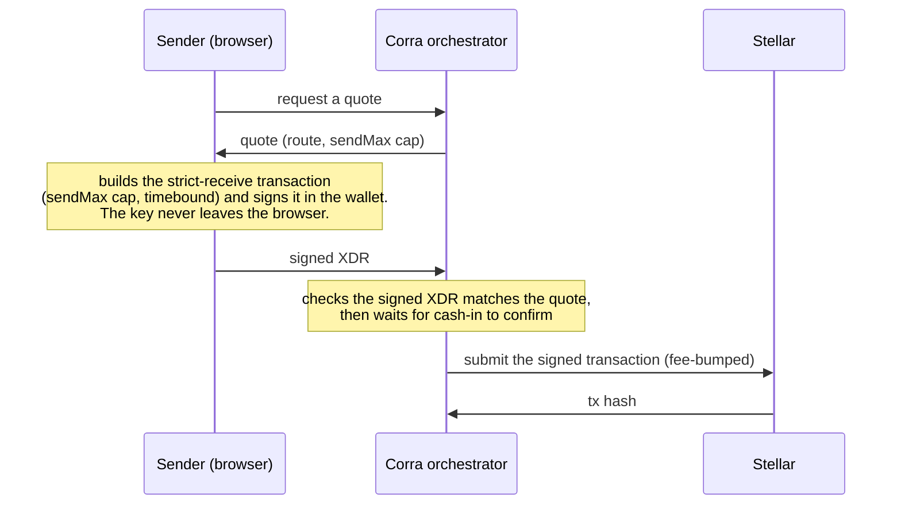
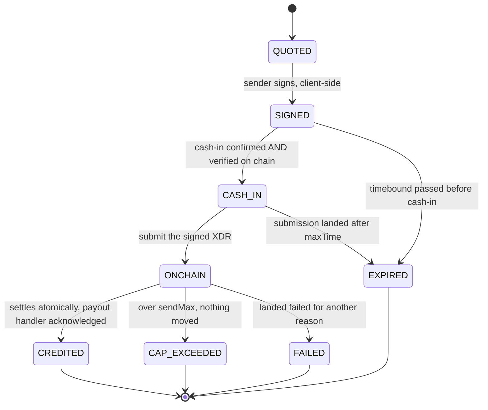

<div align="center">


### Money, teleported.

Corra is a **non-custodial cross-border remittance app on Stellar**.
Send local cash in one country, your recipient gets local cash in another, and nobody ever sees the word "crypto."

[](https://github.com/yigitcangokmen/corramoney/actions/workflows/ci.yml)
[](https://app.corra.money)
[](https://corra.money)
[](https://stellar.org)
[](https://www.typescriptlang.org)
[](LICENSE)

</div>

---

## Try the app

**[app.corra.money](https://app.corra.money)** -- fix what the recipient gets, sign once in Freighter, pay in pesos at the anchor, close the tab. Corra submits the payment you already signed once your cash-in lands on chain.

```
TESTMXN  ->  USDC  ->  TESTPHP      strict-receive, capped by the sendMax you signed
```

Five corridors from Mexico (Philippines, Brazil, Argentina, Indonesia, Thailand). Every step of every payment links to its transaction on stellar.expert.

**Corra never holds a user's key.** Your wallet signs; the orchestrator holds only a fully bound signed transaction and can submit it or not. Details in [Non-custodial by design](#non-custodial-by-design). Proof index: [EVIDENCE.md](EVIDENCE.md).

## Run it yourself

Node 22, pnpm 9, Docker.

```bash
pnpm install
docker compose up -d --wait postgres                       # the ledger
pnpm seed-testnet                                          # issuer, 6 corridor tokens + USDC, market-maker orderbooks, SACs
pnpm onchain-check                                         # Deliverable 1 mechanics on testnet, incl. cap-exceeded and expiry
pnpm exec tsx infra/anchor/setup.ts
docker compose -f infra/anchor/docker-compose.yml up -d --build   # SDF Anchor Platform + the anchor's business server
ANCHOR_HOME_DOMAIN=http://localhost:8080 pnpm --filter @corra/orchestrator start
pnpm drive-payment                                         # one payment through the API and the anchor to CREDITED
pnpm --filter @corra/web dev                               # the app, against your local orchestrator
```

The same commands run in CI: [`quickstart.yml`](.github/workflows/quickstart.yml) from a clean clone, and [`ci.yml`](.github/workflows/ci.yml) with the `no-server-side-signing` job.

| Path | What it is |
|---|---|
| `apps/web` | The sender app. Builds and signs in the browser; SEP-10 and SEP-24 through the wallet SDK. |
| `services/orchestrator` | `/quote`, `/confirm`, saga, submit-on-confirm, reconciler, Postgres ledger. |
| `packages/settlement-saga` | The extractable saga another Stellar wallet can lift ([README](packages/settlement-saga/README.md)). |
| `packages/stellar` | Strict-receive construction, bound-transaction check, sponsor key scope, Horizon gateway. |
| `packages/shared` | Money (bigint, never floats), assets, corridors, wire format. |
| `services/anchor-business`, `infra/anchor` | The test anchor's side: Anchor Platform config and its business server. Not Corra. |

---

## The problem

Cross-border money transfer still settles in 1-3 days and is expensive: the World Bank puts the global average cost of sending $200 at 6.49% in Q1 2025, against a UN Sustainable Development Goal target of 3%, plus an FX spread the sender never sees.

Stellar already solves the settlement half. A single **strict-receive path payment** atomically converts one currency to another through USDC on the open DEX at near-zero cost, and Stellar's own path-finding picks the cheapest route. That part is a commodity, and we treat it as one.

What is missing sits either side of that leg:

**1. A remittance is asynchronous, but signing is not.** Cash-in confirms minutes after the sender has walked away from the kiosk. Every obvious design here reaches for custody, which is the wrong answer for users and impossible for a builder without a money transmission licence. There is no existing Stellar building block for *sign now, settle later, never hold the key*.

**2. A single path payment is not a payment.** No ledger, no idempotency, no refund when the source cost moves past the cap, no recovery when cash-in confirms but settlement was never submitted, no handling for a pre-signed transaction whose timebound expired.

Both are orchestration problems that sit *above* the SEP layer rather than duplicating it.

---

## What we don't build

Corra depends on the ecosystem's existing pieces and writes none of them. This is deliberate and worth being explicit about:

| Concern | What we use | Lines we write |
|---|---|---|
| SEP-1 / SEP-10 / SEP-24 / SEP-38 | [`@stellar/typescript-wallet-sdk`](https://github.com/stellar/typescript-wallet-sdk) (SDF) | none |
| Transactions, Horizon, path payments | [`@stellar/stellar-sdk`](https://github.com/stellar/js-stellar-sdk) (SDF) | none |
| Wallet connection and signing | Freighter via [`@stellar/freighter-api`](https://github.com/stellar/freighter) | none |
| FX routing | Stellar DEX path-finding | none |

We do not implement a SEP client, and we do not wrap the SEPs in a parallel abstraction of our own.

**On SEP-31:** it is an anchor-to-anchor protocol whose sending side requires a licensed entity and bilateral agreements with each counterparty. It is not something a consumer app can implement, and we don't claim to. SEP-24 is the wallet-side standard and is what we use.

**What is left for us to write** is the part no building block provides: the non-custodial signing flow, and the orchestration and ledger around it.

---

## Non-custodial by design

The obvious way to drive an asynchronous payment is to hold the user's key and sign when cash-in lands. Corra does not do that. Instead the transaction is **pre-signed**:



The browser builds the strict-receive transaction itself ([`apps/web/src/logic/remit.ts`](apps/web/src/logic/remit.ts), `buildStrictReceive`). The orchestrator never builds the payment: it checks that the signed XDR matches the quote (`assertBoundPayment` in [`packages/stellar/src/validate.ts`](packages/stellar/src/validate.ts)) and refuses it otherwise.

Corra signs nothing with a user's key, and that is the invariant worth stating precisely rather than as a false absolute. **The server holds two keys of its own, and neither can sign for a user or move user value:**

- **The fee-and-sponsor account**, confined to [`packages/stellar/src/sponsor.ts`](packages/stellar/src/sponsor.ts). CAP-15 fee-bump requires the fee source to sign the envelope, and CAP-33 sponsorship requires the sponsor to sign the setup transaction that opens `BeginSponsoringFutureReserves`, so that signature is unavoidable if the sender is to need no XLM. It signs only fee-bump envelopes around a payment the sender already signed, and sponsorship setup transactions of a fixed shape. It pays network fees and base reserves.
- **Corra's SEP-10 client_domain `SIGNING_KEY`**, in [`services/orchestrator/src/client-domain.ts`](services/orchestrator/src/client-domain.ts). It co-signs the anchor's SEP-10 login challenge so the anchor can attribute the session to Corra. A challenge has sequence 0 and can never be submitted.

The CI job that enforces this is named **`no-server-side-signing`** ([`scripts/no-server-side-signing.ts`](scripts/no-server-side-signing.ts)), and it prints the exact scope it asserts so the name can never be read as broader than the check. It parses every non-test module under `services/orchestrator/src`, `packages/stellar/src`, `packages/settlement-saga/src` and `packages/shared/src`, and fails the build if:

- a `Keypair` is loaded (`fromSecret`, `fromRawEd25519Seed`, `random`, `master`) or a signing call (`sign`, `signTransaction` and similar) is made outside `sponsor.ts` and `client-domain.ts`
- a string literal in that code is seed-shaped (`S[A-Z2-7]{55}`)
- the fee-sponsor secret is referenced anywhere except `config.ts` and `index.ts`, or `index.ts` uses it for anything but `createSponsor()`
- `sponsor.ts` has other than 2 signing call sites, or `client-domain.ts` other than 1

The same job then runs the scanner on a fixture that loads and signs with a key, and fails unless the scanner catches both lines. Finally it runs the `@corra/stellar` unit tests, which check that the sponsor key refuses a fee-bump or setup outside its scope. The scanner is a static check of the source. It does not inspect responses or logs at runtime, and the refusals to touch value are asserted by those unit tests, not by the scanner.

A job that asserted "no signing anywhere" would be asserting something the protocol makes impossible, and would have to be either disabled or quietly narrowed the first time sponsorship was wired up.

This is not only a security posture, it is what makes the architecture legally coherent: the regulated legs (cash-in, cash-out, customer KYC) stay entirely with the licensed anchor, and Corra is an interface and an orchestrator that never touches user funds.

**It has costs, and we fund them rather than hide them:**

- A pre-signed transaction pins a sequence number, so the account cannot transact in between.
- The timebound can expire before cash-in confirms. That is a real failure branch: the transaction dies safely and the sender is asked to sign again, never left silently stuck.

---

## Payment lifecycle

Only the on-chain leg is atomic. The cash-in and cash-out legs are slow and external, so the flow is a saga with compensation built in.



`EXPIRED` leaves from `SIGNED` or `CASH_IN`, never from `ONCHAIN`: a transaction whose timebound passed never enters a ledger at all. `CASH_IN` is never entered on the anchor callback alone, the deposit is independently confirmed from chain state first. And the terminal exits do not loop back, re-signing opens a **new** saga that references the old one by id, so the ledger keeps one row per signed transaction.

Design notes are published in [`/docs`](docs):

| Doc | What's inside |
|---|---|
| [Architecture](docs/architecture.md) | The layers and the boundaries between them. |
| [Flows](docs/flows.md) | The happy path and every failure branch as explicit saga sequences. |
| [Contracts](docs/contracts.md) | The TypeScript type boundaries. |
| [Ledger](docs/ledger.md) | The Postgres schema: saga state, payment legs, append-only event log. |
| [API](docs/api.md) | The `/quote` and `/confirm` HTTP surface. |
| [Testing](docs/testing.md) | How each leg and failure path is verified, end to end. |
| [Risks](docs/risks.md) | Every risk carried into v1, what it costs, and what bounds it. |
| [Demo](docs/demo.md) | What a reviewer sees, in order, and what each step proves. |

---

## What this proves, and what it doesn't

The demo is honest about its own boundaries, and the page labels each step:

| Leg | Status |
|---|---|
| `MXN -> USDC -> PHP` path payment | **real**, on Stellar testnet, verifiable by hash |
| Client-side signing, no user key on the server | **real**, asserted by the `no-server-side-signing` job and unit tests |
| Cash-in | **real protocol, our anchor**: SEP-10, SEP-24 and SEP-38 against a self-hosted SDF Anchor Platform at `anchor.corra.money`; the SPEI transfer behind it is simulated |
| Cash-out in Manila | **mock** payout handler; no fiat moves |
| DEX liquidity | **self-seeded** on testnet, not an open market |

The sender signs in their own Freighter wallet; no key is generated or shipped to the browser. To send without setting up a second wallet, the app offers a public demo recipient account (`demoRecipient` in [`packages/shared/src/testnet.ts`](packages/shared/src/testnet.ts), created by `pnpm demo-recipient`). It holds a trustline for every destination asset and its secret was discarded, so it only ever receives.

**No third-party anchor is integrated yet.** Securing one is BD work, not engineering, and it depends on third parties saying yes. Until then this demonstrates a mechanism, not a live corridor.

---

## Anchor reality check

While mapping which Mexico and Philippines ramps could actually be integrated, we probed the ecosystem directly. `anchors.stellar.org` has no public API, so the directory was scraped and every home domain fetched:

| | |
|---|---|
| Anchor entries in the directory | 79 |
| Declaring no SEP support at all | 48 |
| Home domains probed | 330 |
| Declaring `TRANSFER_SERVER_SEP0024` | 42 |
| Whose SEP-24 endpoint actually responds | **19** |
| Distinct live operators behind those | **~12** |

**Roughly 55% of declared SEP-24 endpoints are dead.** Worse, 22 of the 42 declarations come from domains impersonating real financial institutions: `goldmansachs.com.co`, `bnymellon.com.co`, `pimco.dev` and others, carrying real company names and real CEO names in their `stellar.toml`, pointing at endpoints that do not exist.

This is why Corra scopes carefully. Liquidity on paper is not an integratable ramp, and a directory listing is not a working endpoint.

*Measured 2026-07-28. Numbers move; the method is reproducible.*

---

## Tech stack

| Layer | Choice |
|---|---|
| Language | TypeScript, end to end |
| Stellar | `@stellar/stellar-sdk`, `@stellar/typescript-wallet-sdk` |
| Signing | Freighter via `@stellar/freighter-api` (client-side only) |
| Orchestrator | Node.js + Fastify |
| Database | Postgres (saga state + append-only event log) |
| Frontend | React + Vite |

---

## Status

Testnet, in active development. No real money moves. Mainnet, real KYC and a licensed anchor relationship are explicitly future phases and depend on partners, not on code.

## Contact

Website: [corra.money](https://corra.money) · Twitter / X: [@corra_money](https://x.com/corra_money)

## License

[MIT](LICENSE).
