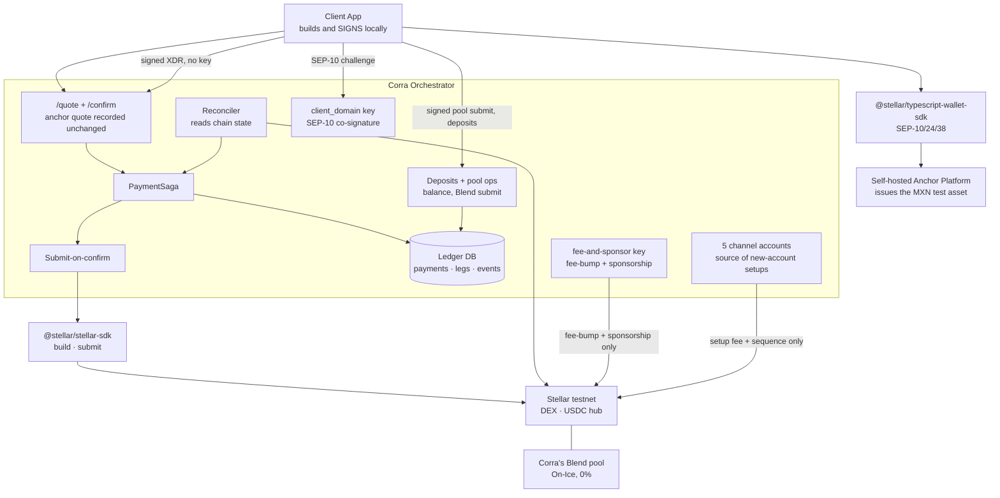
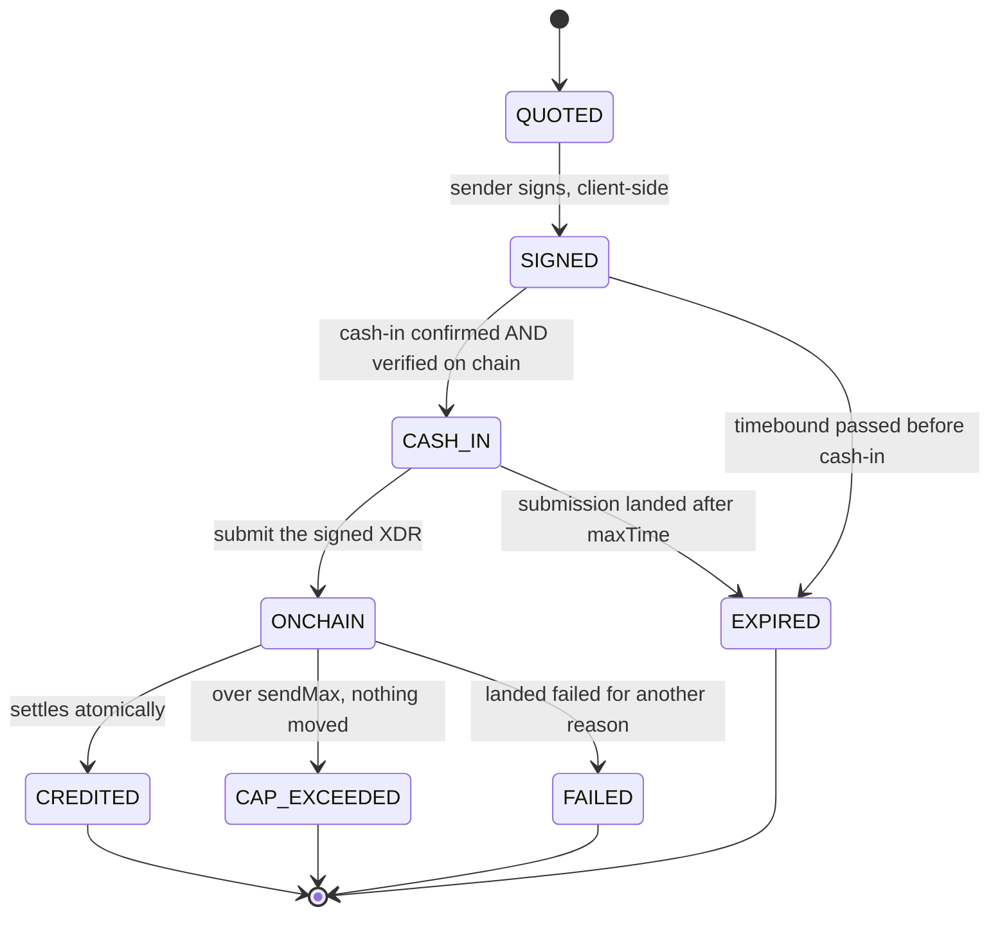
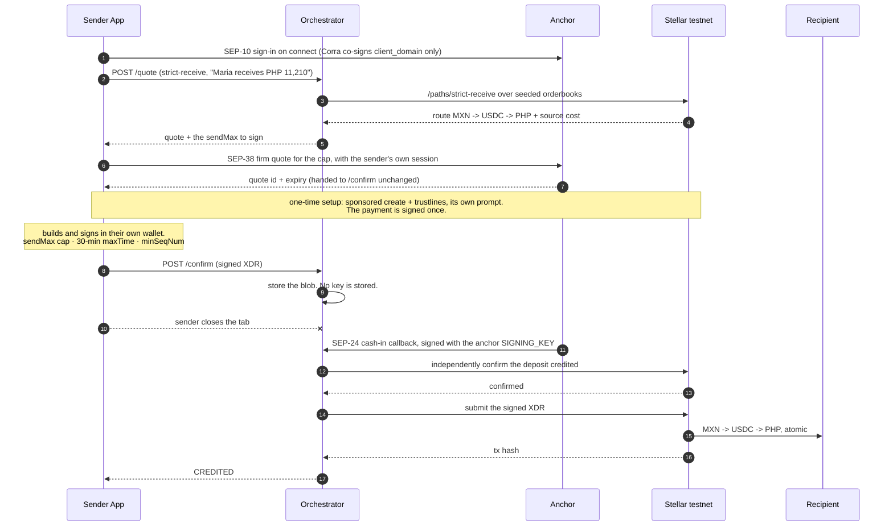

# Corra: Architecture

## 0. Locked-in decisions

| Decision | Choice | Outcome |
|---|---|---|
| **User keys** | **None, anywhere.** | The sender signs the payment in their own wallet. No key that can sign for the sender or hold value is generated, stored, escrowed or recovered by anything Corra runs; setup creates a throwaway key for the 0-XLM payment account, the same transaction sets that key to weight 0, and the key is never stored. |
| **Server keys** | **The fee-and-sponsor account, Corra's SEP-10 client_domain `SIGNING_KEY`, and five channel accounts.** | CAP-15 fee-bump requires the fee source to sign, and CAP-33 requires the sponsor to sign the sponsorship setup. That signature is unavoidable if the sender is to need no XLM. The client_domain key co-signs only sequence-0 SEP-10 challenges so the anchor can attribute the session to Corra. A channel account is only the transaction source of a sponsored setup that creates an account. None signs for a user or can move user value. At startup the orchestrator refuses to run when its sponsor key is not the `feeSponsor` the app looks payment accounts up by. |
| **Recipient** | **Their own Stellar account** | Funds land in an account only the recipient can sign for. `CREDITED` is a safe terminal state. |
| **Cash-in** | **A self-hosted SDF Anchor Platform** | It issues the MXN test asset. No third-party anchor can credit a token minted by our own testnet issuer, so this is structural, not a preference. It runs as SDF Anchor Platform 4.8.0 at `anchor.corra.money` (`infra/anchor`, `deploy/`). |
| **Pricing** | **SEP-38 integration is real; the instance is ours** | No testnet anchor quotes MXN or PHP, so the corridor rate comes from orderbooks our market-maker seeds. v1 demonstrates routing and ordering, not price discovery. |

**Design principle:** the path payment is a commodity and we treat it as one. What we build is the part no existing building block provides: driving an *asynchronous* payment without holding a user's key, and the ledger and failure handling around it.

---

## 1. Layers

```
[ Client / App ]   sender + recipient view · builds and signs locally · never says "crypto"
        │
[ Corra Orchestrator ]
   ├─ /quote + /confirm   route + cap; /confirm records the browser's SEP-38 quote unchanged
   ├─ PaymentSaga         QUOTED · SIGNED · CASH_IN · ONCHAIN · CREDITED
   ├─ Submit-on-confirm   submits the already-signed XDR once cash-in is verified on chain
   ├─ Reconciler          rebuilds saga state from the chain; creates no new state
   └─ Ledger (Postgres)   payments · legs · append-only events
        │
[ Stellar layer ]   sponsored trustlines · strict-receive path payment · market-maker · Horizon
[ Anchor ]          self-hosted Anchor Platform (SEP-10/24/38 via the wallet SDK)
[ Stellar testnet ] DEX liquidity · USDC hub
```

**There is no quote engine in this diagram, and that is deliberate.** `/quote` returns the corridor route from the SDK's path-finding and the `sendMax` cap. The anchor's SEP-38 firm quote is requested by the **browser**, with the sender's own SEP-10 session (`firmQuote` in `apps/web/src/logic/anchor.ts`), because a firm quote needs the user's SEP-10 JWT and Corra never holds user sessions server-side. `/confirm` then records its `id` and expiry on the payment unchanged. We do not compute a rate, and we do not invent a quote format.

**There is no keystore either.** The orchestrator holds the fee-and-sponsor key, the client_domain key, and five channel accounts that only source sponsored setups creating an account (fee and sequence only; no reserve, no value, never a signer), all kept in the deployment's secret store: the fee-and-sponsor account is bounded to fee-bump envelopes and sponsorship setups (`packages/stellar/src/sponsor.ts`), the client_domain `SIGNING_KEY` to SEP-10 challenge co-signatures (`services/orchestrator/src/client-domain.ts`), and the channel accounts to the transaction source of a sponsored setup that creates an account (`packages/stellar/src/channels.ts`).

---

## 2. Anchor integration: what we depend on, what we write

We do not define an abstraction over the SEPs. SEP-1, SEP-10, SEP-24 and SEP-38 are consumed, in the browser, through SDF's [`@stellar/typescript-wallet-sdk`](https://github.com/stellar/typescript-wallet-sdk) as a declared dependency, and we write no SEP client code.

```ts
import { Wallet } from '@stellar/typescript-wallet-sdk'

const anchor  = wallet.anchor({ homeDomain: ANCHOR_HOME_DOMAIN })
const auth    = await anchor.sep10()
const deposit = await anchor.sep24().deposit({ ... })
```

Swapping anchors is changing `homeDomain`. That is the SDK's design, not something we add. **There is no `AnchorAdapter`-shaped interface here**, and writing one before a second anchor exists would be inventing a seam to fit a future we have not met.

**Which anchor, and why it is ours.** The cash-in path is SDF's Anchor Platform 4.8.0, run in Docker (`infra/anchor` locally, `deploy/` for `anchor.corra.money`) and configured to issue the MXN test asset, with a small business server (`services/anchor-business`) that simulates the SPEI transfer. `testanchor.stellar.org` cannot serve this corridor: it deposits only the assets it supports, and no third-party anchor will ever credit a token minted by our own issuer. There is no separate conformance run against it.

The honest consequence: because we run that instance, the cash-in confirmation and the SEP-38 quote behind it are ours. What this demonstrates is the protocol integration and the ordering, not an independent counterparty.

**On SEP-31:** the spec requires both sides to be licensed anchors with bilateral agreements. A consumer app is not a sending anchor. Out of scope, and the wallet SDK does not implement it either.

---

## 3. Flow (sender to recipient)

```
1. QUOTED    strict-receive: "Maria should receive PHP 11,210" -> what the sender pays
2. SIGNED    the sender signs the path payment in their own wallet
             (sendMax cap · 30-minute maxTime · minSeqNum). The signed XDR goes to
             the orchestrator. The key does not.
3. CASH_IN   the anchor reports the deposit AND it is confirmed from chain state.
             Minutes may pass; the sender has left.
4. ONCHAIN   the orchestrator submits the already-signed transaction:
             MXN -> USDC(hub) -> PHP, into the RECIPIENT's account   [ATOMIC]
5. CREDITED  funds are in the recipient's own account: safe terminal state
```

`CREDITED` means the onchain leg landed and the destination amount is in the recipient's own account. The cash-out is the recipient's own step after that, on the same payment's `cash_out` leg (D3): a SEP-24 TESTPHP withdrawal at the test anchor, one recipient-signed payment to the anchor's distribution account that Corra fee-bumps, and the leg `CONFIRMED` only from the anchor's signed `completed` callback plus that payment on chain. The payment's state stays `CREDITED`; the cash pickup behind the anchor is simulated.

**Why the order is safe:** the only atomic point is step 4, and funds rest in an account only the recipient can sign for at step 5.

**Failure branches, and what each actually costs:**

- **Source cost moves past `sendMax`** -> the operation fails with `op_over_source_max` and the transaction lands in a ledger as failed. Nothing moves. The sender still holds the deposited asset in their own account, so **no refund leg runs**. The fee and the sequence number are consumed, so the signed blob is spent and a retry is a new saga.
- **The 30-minute timebound expires before cash-in confirms** -> the transaction never enters a ledger at all. The saga is `EXPIRED` and the sender is asked to sign again. A deposit that already arrived is reused by the re-signed payment. Never silently stuck.
- **The cash-in callback is lost** -> the reconciler reads the deposit from chain state and advances the saga. A lost callback costs a delay, not a stuck payment.

Re-signing never revives a terminal saga. It opens a new one whose `supersedes_id` points at the old, so the ledger keeps one row per signed transaction.

---

## 4. Stellar layer: concrete testnet details

- **No user key; the server's own keys are bounded.** The orchestrator never calls `Keypair.fromSecret` on a user's key and never signs for a user. It holds the fee-and-sponsor key, the client_domain key, and five channel accounts that only source sponsored setups creating an account (fee and sequence only; no reserve, no value, never a signer). The fee-and-sponsor account signs fee-bump envelopes and sponsorship setups, nothing else, and refuses a fee-bump in which it is a source or destination of any operation, or that a channel account sources. The client_domain key co-signs SEP-10 challenges only.
- **Pre-signed transaction:** `pathPaymentStrictReceive` with a `sendMax` cap and a 30-minute `maxTime`, signed client-side and held as an XDR until cash-in is confirmed. Two costs are accepted and handled: it pins a sequence number, and it can expire.
- **`minSeqNum` (CAP-21)** keeps the pre-signed transaction valid across a sequence range instead of one exact value. It widens the window; it does not remove it. If the sender's account transacts past that range during the wait, the transaction is permanently dead and routes to the re-sign path.
- **Account setup:** the sender's account is created by the sponsor with a 0 XLM balance and its trustlines opened under **sponsored reserves** (CAP-33), so the user needs no XLM at any point; friendbot funds only team infrastructure accounts. Sponsorship is a sandwich, and the sponsored account must authorise the closing half, so setup is its own one-time wallet prompt. The payment itself is signed once.
- **Payment account:** every payment and pool step the sender signs has a second sponsored 0-XLM account as its transaction source, the sender's payment account: its master key has weight 0 and its only signer is the sender, so only the sender can move it. The sender stays the operation source and the only signer, and Corra fee-bumps as before. The wallet then never sees the sender as the fee source and runs no fee check (Varial, formerly Freighter, warns "insufficient funds for fee" to a 0-XLM fee source). It is created in its own sponsored transaction, signed by the sponsor and a throwaway browser key that the same transaction sets to weight 0; the key is never stored. It holds no value and only provides the sequence number, so the sender's other wallet activity no longer touches a pre-signed payment's window.
- **USDC hub + market-maker:** a market-maker account seeds MXN/USDC and USDC/PHP offers on the testnet DEX. Without it the path payment has nothing to match against. A testnet setup step, not a product feature, and the reason the corridor rate is ours.
- **Path payment:** route found via `/paths/strict-receive`. The recipient amount is fixed by strict-receive; volatility falls on the source side, bounded by `sendMax`.
- **Reconciliation:** every payment carries an idempotency id. The reconciler runs over this instance's own pending payments only, reads the authoritative fact from Horizon, and advances the saga to match. **The chain outranks the ledger.** Retrying submission is safe because Stellar consumes the sequence number on the first successful submission and rejects every later resubmission of the same blob.

---

## 4a. Month 2: balance, pool, cash-out

- **Balance model.** A sender can add money once (a SEP-24 deposit into their own account, tied to no payment, `deposits` table) and send from that balance later (`POST /send`, payment kind `balance`). The balance itself lives on chain; Corra only records the deposit and confirms it from a chain credit by the anchor's distribution account carrying the deposit's memo, never from a callback alone. The reconciler looks for open deposits by age (every 30 s while young, then every 2 and 10 minutes, at most 5 per pass); the anchor's signed callback and the browser's link check at once. One balance payment is in flight per sender (`409 PAYMENT_IN_PROGRESS`).
- **Pool.** Corra's own TESTMXN lending pool, deployed through Blend's pool factory and kept On-Ice: supply and withdraw on, borrowing off (c_factor = l_factor = 0), take rate 0, so the rate is 0%. The app builds Blend's `submit` with the Blend SDK and the payment account as transaction source; the user signs once and Corra validates (`assertPoolSubmit`) and fee-bumps it. The pool admin and oracle admin is a team script key: it cannot move or lock anyone's deposit without a week of on-chain notice, and withdrawals work in every pool state ([risks](risks.md) R22).
- **Cash-out leg.** `CREDITED` means the recipient's account holds the destination asset; the payment's `cash_out` leg stays `PENDING` until the recipient withdraws at the anchor (one recipient-signed payment to the anchor's distribution account, Corra fee-bumps) and turns `CONFIRMED` only on the anchor's signed `completed` callback plus that payment on chain.
- **Channel accounts.** Five team accounts, each leased to one sign-up at a time as the transaction source of its sponsored setup, so concurrent sign-ups do not collide on the sponsor's sequence number.
- **Analytics.** A self-hosted GoatCounter counts page views and three named events; nothing about addresses, amounts or hashes ([risks](risks.md) R25).
- **Testnet reset.** `pnpm redeploy-after-reset` rebuilds the testnet side with the same keys after an SDF reset; only the pool's ids change ([testnet-reset](testnet-reset.md)).

---

## 5. Proposed repository layout

A pnpm monorepo, end-to-end **TypeScript**:

```
apps/web                 sender app; builds and signs locally; SEP-10/24/38 via the wallet SDK
services/orchestrator    /quote + /confirm, SEP-24 callback verifier, client_domain signer, Postgres ledger
services/anchor-business the test anchor's business server (not Corra)
packages/settlement-saga the extractable module another wallet can lift
packages/stellar         strict-receive construction, bound-transaction check, sponsor key, Horizon gateway
packages/shared          types: Money, Quote, Corridor, AssetId, wire format
```

DB: Postgres (saga state + timeline).

---

## 6. Deferred, with a slot reserved

| Deferred | How it slots in |
|---|---|
| A real anchor | wallet SDK `homeDomain` for SEP-24 anchors; a thin client only for a non-SEP ramp |
| Real KYC/compliance | SEP-12 through the wallet SDK, driven by the anchor |
| A real payout leg | The SEP-24 withdrawal is already the shape; a licensed anchor replaces the test anchor's simulated cash pickup. Needs a partner, not more code |
| Mainnet | Requires that partner relationship |
| A re-sign notification path | What would let a slow cash-in rail work at all. See the limits below |
| Automated recovery of a lost `completed` withdrawal callback | Manual today ([risks](risks.md) R20); asking the anchor without its signed callback would be a new trust path |
| A stored-cursor payout poller | The bounded scan holds at testnet volume ([risks](risks.md) R19) |
| A separate production channel set, alerting | Mainnet gates ([risks](risks.md) R13, R23) |

Passkey and Soroban smart-wallet signing is **not** a drop-in: a contract address cannot be the source account of a classic `pathPaymentStrictReceive`. Moving there would mean moving FX off the classic DEX, which is a different architecture.

---

## 7. Limits carried into v1

- **The 30-minute window bounds this to fast cash-in.** The design assumes cash-in confirms inside the signature window, which holds for instant rails and for a local anchor instance. Slower rails such as a bank transfer or an OXXO cash deposit exceed it and fall to the re-sign path. Widening the window without weakening the cap is Phase 2 work and is not solved here.
- **The orchestrator can decline to submit.** That is indistinguishable from expiry and costs the sender nothing, since funds never left their account. The signed XDR is also returned to the sender's browser, so they can submit it to any Horizon themselves. Because the inner transaction relies on Corra's fee-bump, doing so requires their own XLM or their own fee-bump wrapper, so the escape hatch is real but not free.
- **No custodial throwaway key.** The earlier demo at test.corra.money generated a testnet account server-side and sent its secret to the browser so a reviewer could click without a wallet; that custodial shortcut is gone. The app in this repo (`apps/web`, served at app.corra.money) requires the sender's own Freighter wallet, and no key that can sign for the sender or hold value is generated, sent or stored anywhere; setup creates a throwaway key for the 0-XLM payment account, the same transaction sets that key to weight 0, and the key is never stored.

---

## 8. Sub-decisions (resolved)

| Question | Decision | Rationale |
|---|---|---|
| **App framework** | **React + Vite (SPA)** | Signing happens in the client, so it must be a real client and not an SSR surface. The orchestrator is a separate Fastify service. |
| **Quote** | **SEP-38 firm quote from the anchor, requested by the browser, recorded unchanged** | The browser requests it with the sender's own SEP-10 session; `/confirm` records it. We add only the saga identifier and the `sendMax` the sender signs. The corridor leg comes from path-finding over seeded orderbooks, and that is stated wherever the claim is made. |
| **Signing timing** | **Sign before cash-in, submit after** | A remittance is asynchronous: cash-in confirms after the sender has left. Signing up front is what removes the need for custody. |
| **Timebound length** | **30 minutes** | Long enough for an instant rail and a local anchor, short enough that a stale signed transaction cannot linger. A slow rail needs a re-sign notification path, which is Phase 2. |
| **Ledger schema** | **`payments` + `legs` + append-only `payment_events`** | State lives in `payments`/`legs`; the timeline is fed from the event log. Full event-sourcing is overkill. |
| **Market-maker seed** | **Fixed offers**, wide depth around the pegged rate | A dynamic MM is unnecessary complexity. Re-seeding is manual. |

## 9. Diagrams

### 9.1 Components



### 9.2 Saga state machine



`EXPIRED` leaves from `SIGNED` or `CASH_IN`, never from `ONCHAIN`: a transaction whose timebound passed never enters a ledger at all, so there is no on-chain state to leave from. `CASH_IN` is never entered on the anchor callback alone; the deposit is independently confirmed from chain state first. `FAILED` records any other on-chain failure (for example the recipient removed their trustline) with the Horizon result code. `EXPIRED` is only written after `maxTime` plus a 120-second grace period, and only when the transaction is not on chain. The terminal exits do not loop back. Re-signing opens a **new** saga referencing the old one by id, so the ledger keeps one row per signed transaction. The cash-out is not a payment state: it lives on the `cash_out` leg of a `CREDITED` payment, with its own events (`from = to = CREDITED`).

### 9.3 End-to-end flow (sequence)


