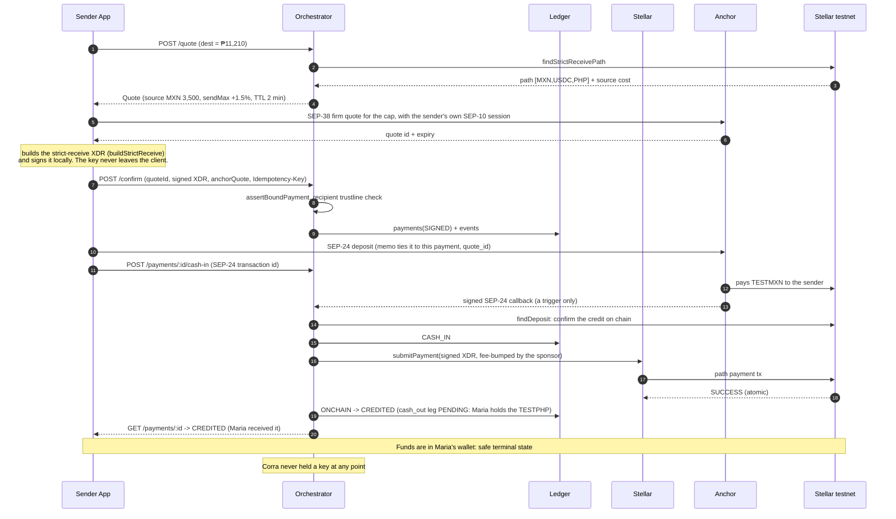
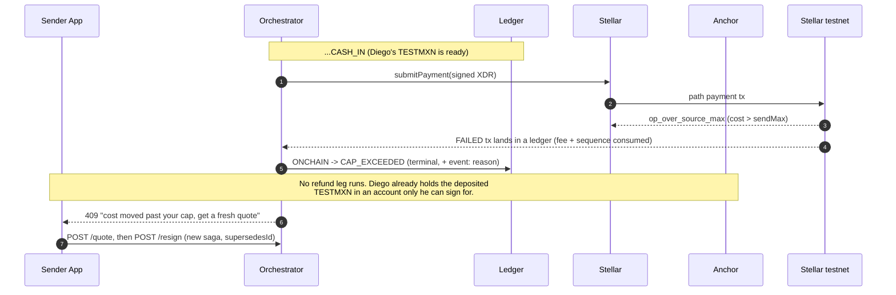
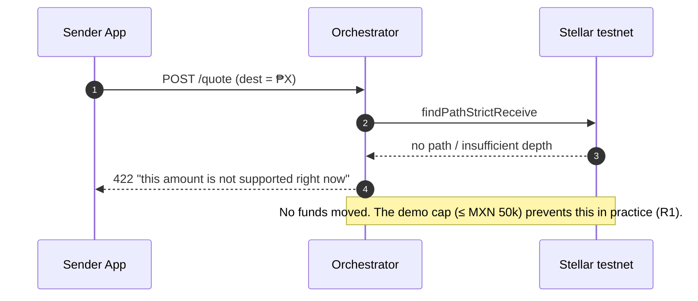
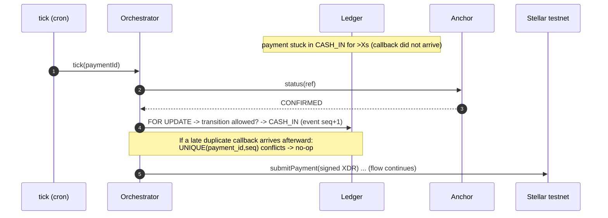
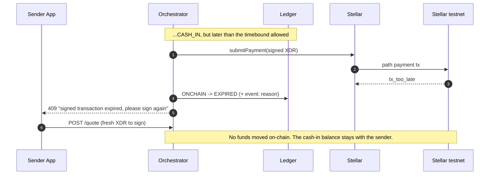

# Corra: Flows (happy + failure paths)

> Concrete sequences for the saga. There is one happy path; the failure paths are handled separately (no silent failures, every error transitions to a state). See also [contracts](contracts.md) and [ledger](ledger.md).

## 1. Happy path (Diego MX -> Maria PH)



## 2. Failure: over-sendmax (exchange rate moved)

After cash-in, the market moves and the actual source cost exceeds `sendMax`, so the operation fails on chain. **Nothing moves**: no path payment is applied and the sender keeps the deposited asset in an account only they can sign for. The fee and the sequence number are consumed, so the signed blob is spent and a retry is a new saga.



## 3. Failure: no route / insufficient liquidity

If market-maker depth is insufficient, no path is found. This error is caught at the quote stage **before confirm** -> cash-in never starts (the cleanest failure).



## 4. Failure: callback loss -> reconcile (tick)

If the anchor callback never arrives, the payment is stuck in PENDING. The reconciler pulls the authoritative fact from Horizon and from the SEP-24 transaction status, and advances the saga to match. Repeated delivery is harmless at the ledger level, and **exactly-once submission comes from the protocol**: Stellar consumes the sequence number on the first successful submission and rejects every later resubmission of the same blob.



## 5. Failure: the signed transaction expired

Signing happens before cash-in, so a slow cash-in can outlive the timebound. The transaction dies safely and the sender re-signs. This is the cost of not holding a key, and it is funded rather than hidden.



## 6. Cash-out: the recipient withdraws at the anchor (D3)

The payment is `CREDITED` and stays so. The recipient's withdrawal is recorded on its `cash_out` leg.

```mermaid
sequenceDiagram
    autonumber
    participant R as Recipient App
    participant A as Anchor (SEP-24)
    participant B as Anchor business server
    participant O as Orchestrator
    participant K as Stellar (fee-bump)
    participant X as Stellar testnet

    R->>A: SEP-10 (recipient's own session), SEP-24 withdraw TESTPHP, amount = the payment's
    A-->>R: interactive URL (incomplete)
    R->>B: the anchor's page: Confirm withdrawal
    B->>A: request_onchain_funds (pending_user_transfer_start; the anchor generates the memo)
    R->>A: GET transaction: withdraw_anchor_account, amount_in, withdraw_memo
    Note over R: checks account = disclosed distribution, exact amount, memo present<br/>Sign the withdrawal: one Freighter prompt (tx source = payment account, op source = recipient)
    R->>O: POST /payments/:id/cash-out/submit {ref, signedXdr}
    O->>O: assertCashOutPayment, payment account, balance, next sequence
    O->>O: record ref + inner hash on the leg (CAS), CASH_OUT_SUBMITTED
    O->>K: submitPayment (sponsor fee-bump)
    K->>X: payment to the distribution account, with the memo
    O->>O: CASH_OUT_ONCHAIN
    B->>X: poller: the oldest payment with the memo, asset and exact amount
    B->>A: notify_onchain_funds_received, then notify_offchain_funds_sent (simulated cash pickup)
    A-->>O: signed callback: completed, withdraw_memo, external_transaction_id
    O->>X: the leg's own transaction: from, destination, asset, amount, memo
    O->>O: CASH_OUT_ANCHOR_COMPLETED, CASHED_OUT (leg CONFIRMED)
```

A callback before the chain shows the payment is kept as an event; the reconciler confirms once Horizon catches up. A `completed` or stopped callback is written before Corra answers `200`; if writing fails Corra answers `503` and the anchor resends. A blob that can never land (landed failed, or not on chain 120 s after its `maxTime`) is cleared from the leg, so the recipient can sign again; one that may still land blocks a second one.

## Summary
- **Single atomic point:** the path payment (third leg). Everything before and after is saga.
- **Every failure transitions to a state:** over-sendmax -> CAP_EXCEEDED (terminal, re-sign opens a new saga), no-path -> 422 at quote, callback-loss -> tick reconcile, expired timebound -> EXPIRED (terminal, re-sign opens a new saga).
- **Funds never evaporate:** either still in the sender's own account (nothing moved, so nothing needs refunding), or in the recipient's wallet (`CREDITED` is the safe terminal state).
